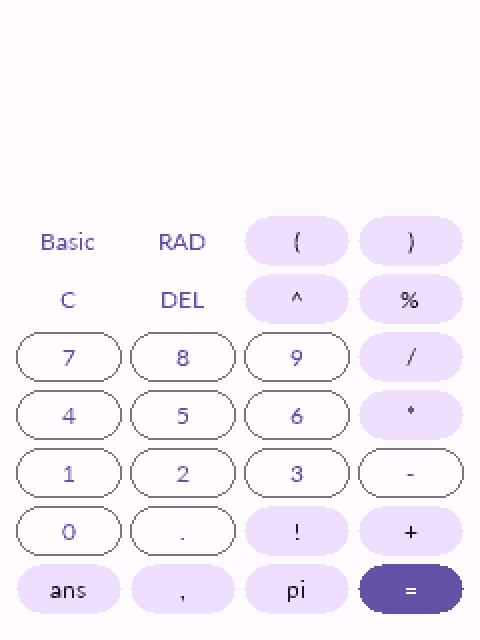
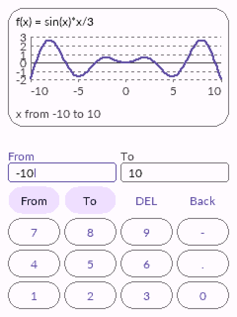

# Calculator GUI (optional)

`TinyCalculatorGui.h` provides a calculator keypad built on
[TinyMaterialDesign](https://github.com/pschatzmann/TinyMaterialDesign). It is
**not** included by `TinyCalculator.h`, so the core library has no GUI
dependency. Include it explicitly:

```cpp
#include <TinyCalculatorGui.h>

App<RGB565> app(DefaultBoard);
CalculatorGui<RGB565, float> gui(Bounds(0, 0, 240, 320));  // or <RGB565, double>

void setup() { app.begin(); gui.begin(app.screen()); }
void loop()  { app.update(); }
```

It needs TinyMaterialDesign (and therefore TinyGPU) on the include path.

## Themes and fonts

The calculator is drawn with a TinyMaterialDesign theme
(`CalculatorTheme<RGB_T>`, the `MaterialTheme` of the widgets). It is the
argument of the constructor, or of `setTheme()`:

```cpp
CalculatorGui<RGB565, float> gui(Bounds(0, 0, 240, 320), tinymd::greenTheme<RGB565>());
gui.setTheme(tinymd::defaultDarkTheme<RGB565>());   // at any time
```

The fonts are part of the theme: its `typography` holds the font of each role.
The expression line and the chart text use the `body` font, the result line
the `headline` font, and the keys, chart axes and field labels the `label` font. Fonts are assigned with a function defined in the sketch:

```cpp
void calculatorFonts(CalculatorTheme<RGB565>& theme) {
  theme.typography.label = &smallFont;      // keys, chart axes, field labels
  theme.typography.body = &smallFont;       // expression line, chart title and footer
  theme.typography.headline = &resultFont;  // result line
}

setup() { ...; calculatorGui.assignFonts(calculatorFonts); calculatorGui.begin(app.screen()); }
```

`begin()` applies the theme to the screen, so it also changes the keys and
other widgets on that screen.

## TinyFonts

[TinyFonts](https://github.com/pschatzmann/TinyFonts) gives smooth,
anti-aliased text. The GUI example always uses it: it assigns `tinyfonts::Lato16`
and `Lato32` in `calculatorFonts()`. Building the GUI therefore needs TinyFonts;
point `TINYCALC_TINYFONTS_DIR` at a checkout if it is not next to this project.

## Sizes

The layout adapts to the area it is given (`CalculatorGui(Bounds(...))`,
`setBounds()`):

- **Tall areas** (portrait) stack the display above the keys.
- **Wide areas** (landscape) put the display on the left and the keys on the right.

The keys and the plot fields take the space the display does not need. Call
`setBounds()` to change the size at runtime, for example after a rotation.

Sizes from about 160×240 (portrait) and 320×200 (landscape) are readable.
Smaller areas still lay out, but the key labels no longer fit on the keys.

## Screens

All keypad pages, shown at the same size:

<table>
<tr>
<td align="center"><br><b>Basic</b></td>
<td align="center"><br><b>Trig</b></td>
</tr>
<tr>
<td align="center"><br><b>Math</b></td>
<td align="center"><br><b>Special</b></td>
</tr>
</table>

## Input rules

The keypad only accepts keys that continue the expression validly. A key that
does not fit is ignored:

- an operator (`+ * / ^ %`) needs a number, name, `)` or `!` before it
- `-` may start an expression or follow an operator, as a sign (`2*-3`)
- `)` and `,` need an open `(` (a function call)
- `!` needs a number, name or `)` before it
- a number has at most one `.`
- after `=`, an operator continues with `ans`; any other key starts over

A name followed by a digit, a name or `(` gets an explicit `*`, so `pi` then
`2` is `pi*2`.

## Swipes

- **Swipe right**: next keypad page (Basic → Trig → Math → Special → Basic).
- **Swipe left**: previous keypad page. On the plot screen it returns to the keypad.

A swipe works wherever it starts, including on a key. Pages wrap around, the
same as the **page** key.

## Keypad

The keypad has four pages. The top-left key shows the current page name
(`Basic`, `Trig`, `Math`, `Special`) and switches to the next page.

| Page | Keys |
|------|------|
| Basic | digits, `+ - * / ^ %`, `!`, `( ) ,`, `ans`, `pi`, `=`, `C`, `DEL`, `RAD`/`DEG` |
| Trig | `sin cos tan asin acos atan atan2 sec csc cot asec acsc acot sinh cosh tanh asinh acosh atanh deg rad e tau phi` |
| Math | `sqrt cbrt root pow exp exp2 expm1 ln log log2 log10 abs floor ceil round trunc frac sign mod hypot clamp min max sum avg gcd lcm` |
| Special | `gamma fact erf erfc comb perm`, `! % ( ) , ans pi e tau phi ^`, `Plot`, `x` |

Every function and constant of the library has a key.

## Plotting

`x` enters the variable x. `Plot` samples the current expression as a
function of x and shows it in a chart with the formula as title. The range
of x is given by the **From** and **To** fields (default -10 and 10). Points
where the expression is undefined (for example `sqrt(x)` for negative x) are
left as gaps.

On the plot screen:

- Tap **From** or **To**, or use the matching keys, to select a field.
- The numeric pad types into the selected field: digits, `-` (at the start)
  and `.`. **DEL** deletes the last character.
- The chart is redrawn whenever both fields hold a valid range with To above
  From. An invalid range keeps the last valid plot.
- **Back** returns to the keypad. The expression is kept.



The default range can also be set in code with `gui.setPlotRange(xMin, xMax)`.

## Behaviour

- Digits, operators and function keys append to the expression.
- `=` evaluates the expression. The result, or the error, is shown in the
  result line. Nothing is evaluated before `=`.
- After `=`, an operator continues with the result (`ans`); a digit or
  function starts a new expression.
- `C` clears everything, `DEL` removes the last character.
- `RAD`/`DEG` toggles the angle unit.
- `gui.calculator()` gives access to the underlying `Calculator`, for
  variables and the angle unit.
