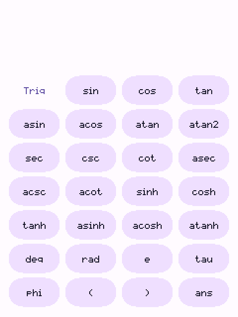
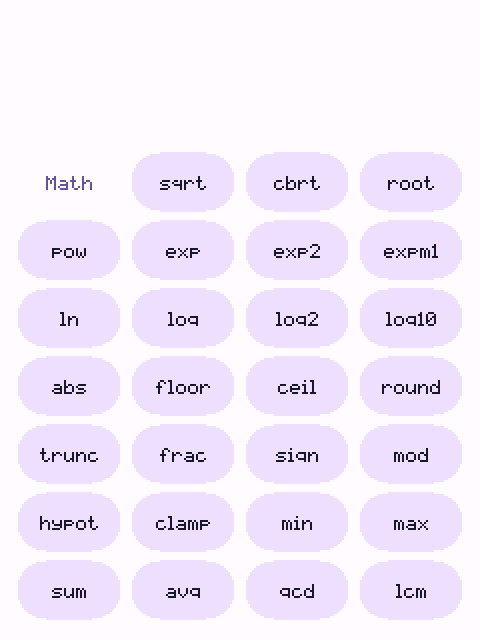
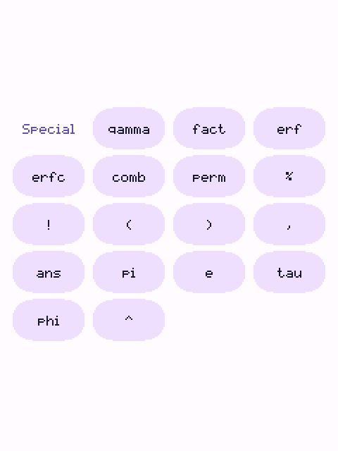

# Calculator GUI (optional)

`TinyCalculatorGui.h` provides a calculator keypad built on
[TinyMaterialDesign](https://github.com/pschatzmann/TinyMaterialDesign). It is
**not** included by `TinyCalculator.h`, so the core library has no GUI
dependency. Include it explicitly:

```cpp
#include <TinyCalculatorGui.h>

App<RGB565> app(DefaultBoard);
CalculatorGui<RGB565, float> gui(Bounds(0, 0, 240, 320));  // or <RGB565, double>

void setup() { app.begin(); gui.attach(app.screen()); }
void loop()  { app.update(); }
```

It needs TinyMaterialDesign (and therefore TinyGPU) on the include path.

## Screens

All keypad pages, shown at the same size:

<table>
<tr>
<td align="center"><br><b>Basic</b></td>
<td align="center"><br><b>Trig</b></td>
</tr>
<tr>
<td align="center"><br><b>Math</b></td>
<td align="center"><br><b>Special</b></td>
</tr>
</table>

## Keypad

The keypad has four pages. The top-left key shows the current page name
(`Basic`, `Trig`, `Math`, `Special`) and switches to the next page.

| Page | Keys |
|------|------|
| Basic | digits, `+ - * / ^ %`, `!`, `( ) ,`, `ans`, `pi`, `=`, `C`, `DEL`, `RAD`/`DEG` |
| Trig | `sin cos tan asin acos atan atan2 sec csc cot asec acsc acot sinh cosh tanh asinh acosh atanh deg rad e tau phi` |
| Math | `sqrt cbrt root pow exp exp2 expm1 ln log log2 log10 abs floor ceil round trunc frac sign mod hypot clamp min max sum avg gcd lcm` |
| Special | `gamma fact erf erfc comb perm`, `! % ( ) , ans pi e tau phi ^` |

Every function and constant of the library has a key.

## Behaviour

- Digits, operators and function keys append to the expression.
- `=` evaluates the expression. The result, or the error, is shown in the
  result line. Nothing is evaluated before `=`.
- After `=`, an operator continues with the result (`ans`); a digit or
  function starts a new expression.
- `C` clears everything, `DEL` removes the last character.
- `RAD`/`DEG` toggles the angle unit.
- `gui.calculator()` gives access to the underlying `Calculator`, for
  variables and the angle unit.
